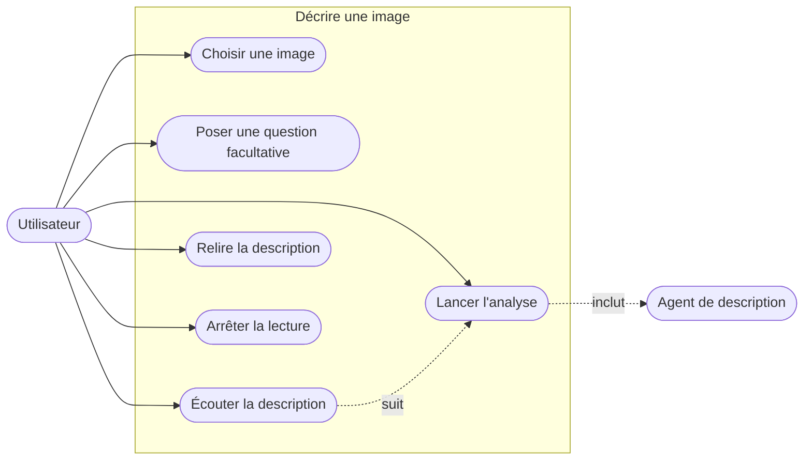
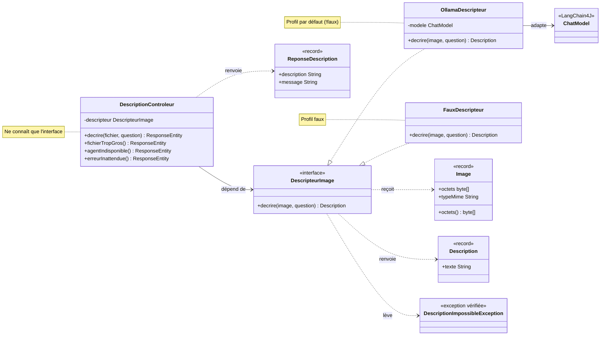
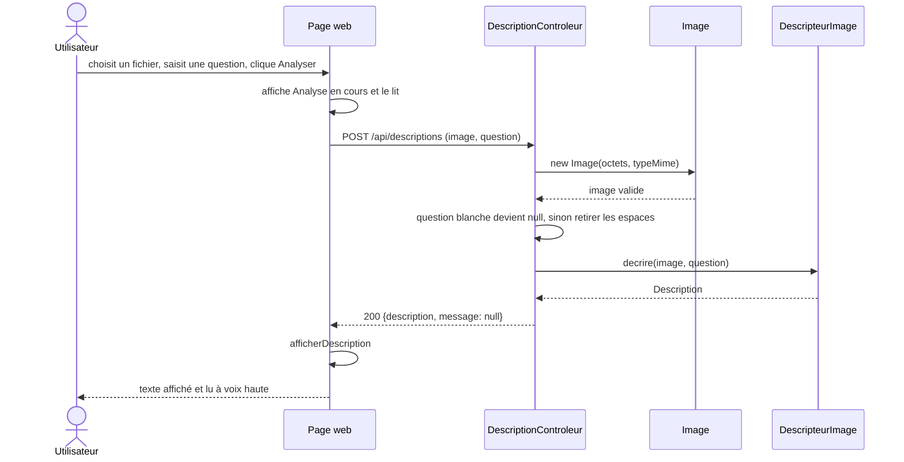
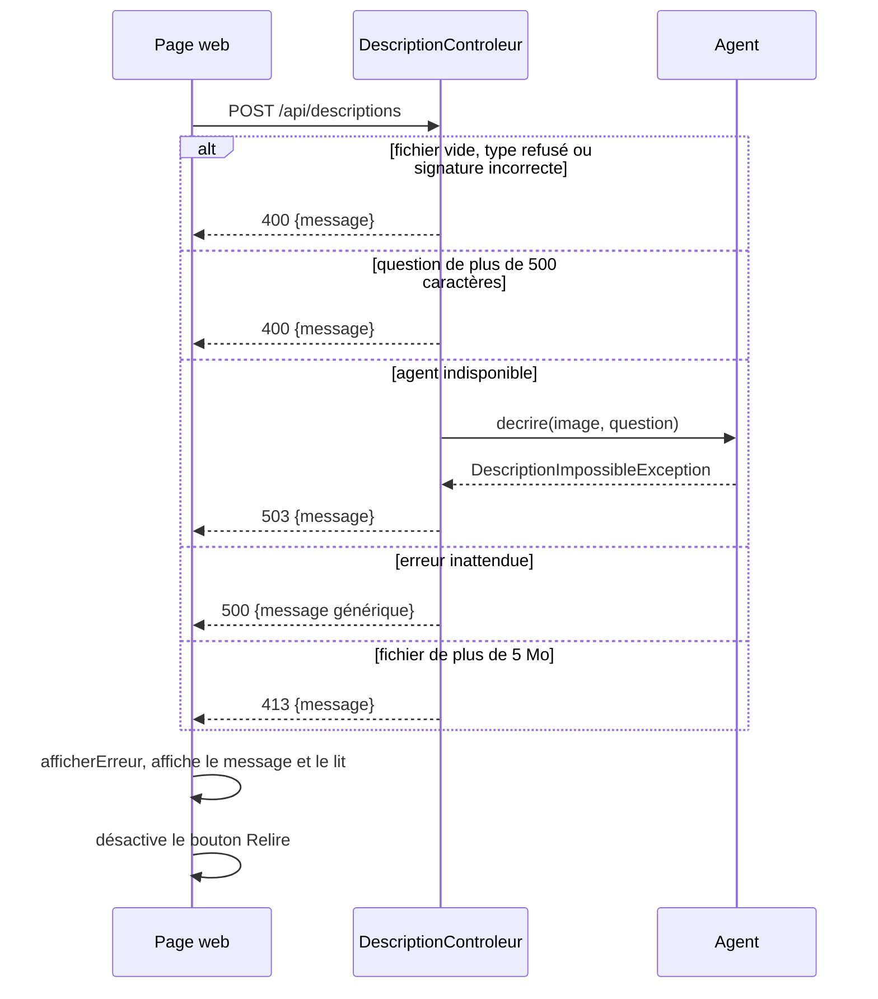
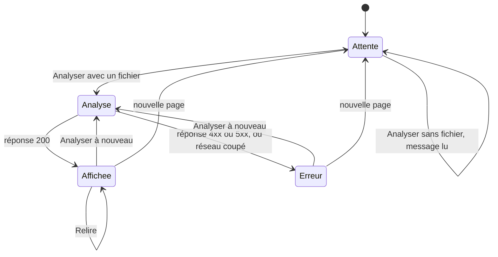
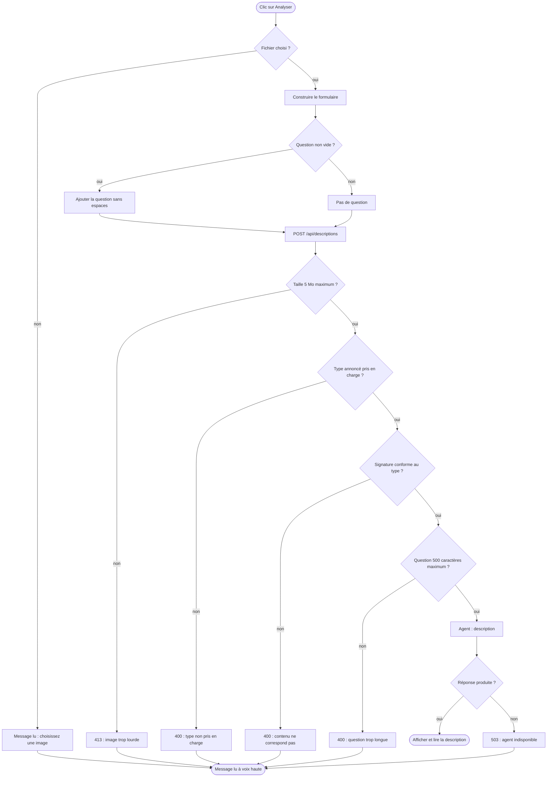
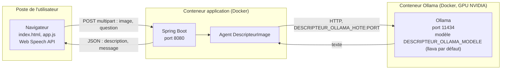
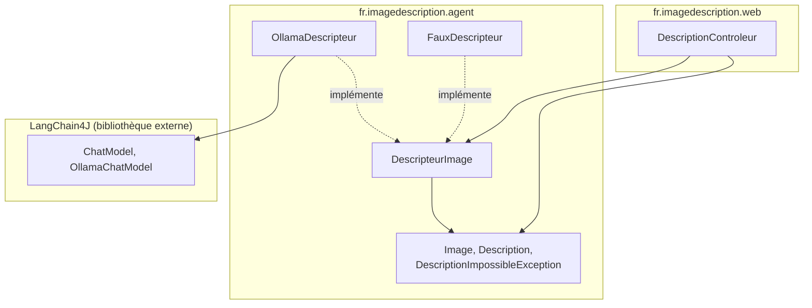
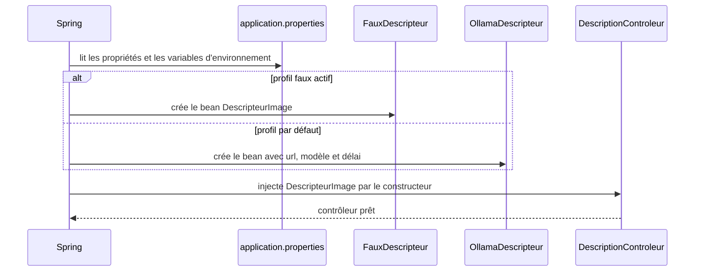

# 03 - Diagrammes UML

Les diagrammes sont écrits en Mermaid. GitHub les affiche directement. Chaque diagramme correspond à une question différente sur le système.

| # | Diagramme | Question à laquelle il répond |
| --- | --- | --- |
| 1 | Cas d'utilisation | que peut faire l'utilisateur ? |
| 2 | Classes | quelles sont les classes et leurs dépendances ? |
| 3 | Séquence : analyse réussie | que se passe-t-il, dans l'ordre, pour une image valide ? |
| 4 | Séquence : erreurs | comment chaque erreur remonte-t-elle jusqu'à la voix ? |
| 5 | États de l'interface | dans quel état se trouve la page ? |
| 6 | Activité : validation | quelles vérifications sont faites, et dans quel ordre ? |
| 7 | Composants et déploiement | quels processus communiquent, et sur quel port ? |
| 8 | Paquets | comment le code est-il découpé, et quelle règle de dépendance est respectée ? |
| 9 | Séquence : choix de l'agent | comment Spring choisit l'implémentation ? |

## 1. Cas d'utilisation

## 2. Classes

## 3. Séquence : analyse réussie

## 4. Séquence : erreurs

## 5. États de l'interface

## 6. Activité : validation d'une demande

## 7. Composants et déploiement

## 8. Paquets

**Règle vérifiée** : aucune flèche ne part de `web` vers `lc4j`, et seule `OllamaDescripteur` dépend de `lc4j`.

## 9. Choix de l'implémentation au démarrage

